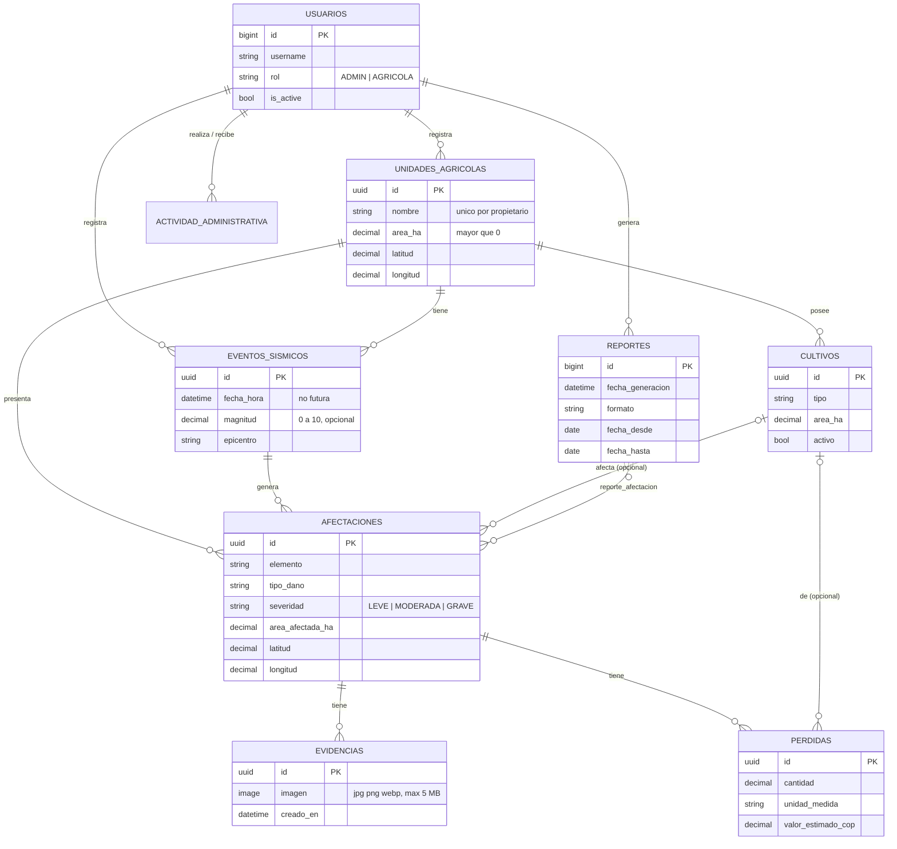

# Esquema de base de datos de AgroSismo

Modelo Django sobre MySQL (SQLite solo para desarrollo). Parte de su diagrama ER y de la SRS (RF-05 a RF-20).



## Decisiones de diseño

- **UUID como clave primaria** en todo lo que se registra en el campo (unidades, cultivos, eventos, afectaciones, evidencias, pérdidas). El cliente offline lo genera sin hablar con el servidor y, si reenvía el registro tras una conexión caída, el servidor actualiza la misma fila en lugar de duplicarla (riesgos R-01, R-02, R-20). `sincronizado_en` vacío significa "pendiente"; reemplaza el booleano `sincronizado` del ER. Reportes y usuarios se crean siempre en línea y usan id autoincremental.
- **Las unidades no se borran con el usuario** (`PROTECT`) y las cuentas se desactivan con `is_active` (RF-04), para no perder historial.
- **Integridad en la propia BD**, no solo en los formularios (riesgos R-06, R-07): áreas mayores que 0, magnitud 0–10, latitud/longitud en rango, pérdidas no negativas, rango de fechas del reporte coherente, nombre de unidad único por propietario y un mismo sismo no se repite en la misma unidad.
- **Validaciones de negocio** en `clean()` (se ejecutan con `full_clean()`, que usarán los formularios y la API): el sismo no puede estar en el futuro, la unidad debe ser del usuario, la afectación debe estar en la misma unidad que su evento, el cultivo debe pertenecer a esa unidad y el área afectada no puede superar el área de la unidad.
- **Pérdidas son estimaciones del usuario** (riesgo R-21): tabla `perdidas` aparte, con varias filas posibles por afectación (por ejemplo, una por cultivo).

## Diferencias respecto a su ER (para que las revisen)

| ER original | Esquema actual | Motivo |
|---|---|---|
| `EVENTO_SISMICO` sin unidad | `eventos_sismicos.unidad_id` | RF-08 pide asociar el evento a una unidad. Un mismo sismo real que afecte dos fincas se registra una vez por finca. |
| `fecha` y `hora` separadas | `fecha_hora` (un solo campo) | Evita fechas sin hora y simplifica el filtro por rango. |
| `producción_perdida` y `valor_economico` dentro de `AFECTACION` | tabla `perdidas` | Coincide con su diagrama de arquitectura (entidad "Pérdidas") y permite varias pérdidas por afectación. |
| `FOTOGRAFIA(url, fecha_captura)` | `evidencias(imagen, creado_en)` | Mismo propósito; `creado_en` es la fecha de captura. |
| `USUARIO.contrasena`, `activo` | `Usuario` de Django (`password` con hash, `is_active`) | Django guarda la contraseña cifrada. |
| `UNIDAD_AGRICOLA.ubicacion` (texto) | departamento, municipio, vereda, latitud, longitud | Permite filtrar y ubicar en mapa más adelante. |
| (no existía) | `actividad_administrativa` | RNF-09: bitácora de la gestión de cuentas. |

## Cómo ponerlo a correr

```bash
cd agrosismo
python -m venv .venv && source .venv/bin/activate
pip install -r requirements.txt        # mysqlclient necesita las librerías de desarrollo de MySQL
cp .env.example .env                   # edita y exporta las variables (sin DB_NAME usa SQLite)
python manage.py makemigrations accounts agro afectaciones
python manage.py migrate
python manage.py test                  # corre las pruebas de integridad
python manage.py createsuperuser
python manage.py runserver             # panel en /admin/
```

Orden de migraciones: `accounts` primero (el usuario personalizado), luego `agro` y `afectaciones`.
